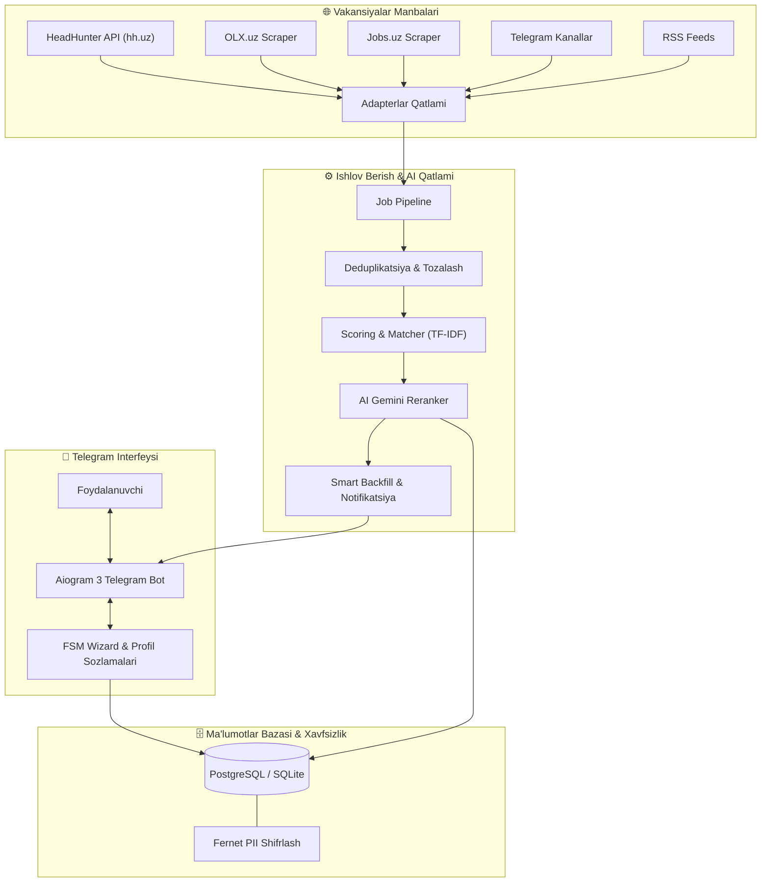

<div align="center">

# 🤖 @Uzmyjob_bot

### O'zbekiston mehnat bozori uchun AI asosidagi avtomatlashtirilgan vakansiyalar agregatori va ishga topshirish boti

[](https://www.python.org/)
[](https://docs.aiogram.dev/)
[](LICENSE)
[](https://github.com/AdhamIsoqov/Uzmyjob_bot/releases)
[](https://github.com/astral-sh/ruff)
[](https://www.postgresql.org/)
[](https://ai.google.dev/)

<p align="center">
  <a href="#-loyiha-haqida">Loyiha haqida</a> •
  <a href="#-asosiy-imkoniyatlar">Imkoniyatlar</a> •
  <a href="#-tizim-arxitekturasi">Arxitektura</a> •
  <a href="#-texnologiyalar-steki">Texnologiyalar</a> •
  <a href="#-tezkor-boshlash">Tezkor Boshlash</a> •
  <a href="#%EF%B8%8F-konfiguratsiya-env">Konfiguratsiya</a> •
  <a href="#-loyiha-tuzilishi">Tuzilishi</a> •
  <a href="#-testlash-va-sifat-nazorati">Testlash</a> •
  <a href="#-production-deploy">Deploy</a>
</p>

</div>

---

## 📌 Loyiha haqida

**@Uzmyjob_bot** — O'zbekiston mehnat bozoridagi bo'sh ish o'rinlarini yagona platformaga jamlovchi, sun'iy intellekt (Gemini Flash va TF-IDF) orqali nomzod rezyumesiga moslashtiruvchi va arizalarni avtomatlashtiruvchi zamonaviy Telegram bot ekotizimi.

Odatda ish qidiruvchilar HeadHunter, OLX, Jobs.uz va turli Telegram kanallarini alohida kuzatishga va har biriga qo'lda ariza topshirishga majbur. Ushbu bot barcha jarayonni bitta xavfsiz va aqlli bot ichida birlashtiradi.

---

## ✨ Asosiy imkoniyatlar

- 🎯 **Interaktiv Telegram FSM Wizard:**
  - Ko'p bosqichli profil to'ldirish (mutaxassislik, shahar, ish tajribasi, kutilayotgan maosh, bandlik turi).
  - Tezkor inline tugmalar (Toshkent, Samarqand, Masofaviy / Full-time, Part-time, Freelance).
  - Rezyume (PDF, DOCX) tahlili va ko'nikmalarni avtomatik ajratib olish.
  - Yangi foydalanuvchilar uchun oxirgi 7 kunlik mos vakansiyalarni bir zumda tavsiya qilish (*Smart Backfill*).

- 🌐 **Ko'p manbali vakansiyalar agregatsiyasi (Multi-Source Scraper):**
  - **HeadHunter (hh.uz API):** Rasmiy OAuth integratsiyasi va to'g'ridan-to'g'ri ariza topshirish.
  - **OLX.uz:** Ish bo'limidagi e'lonlarni toza parse qilish va kontaktlarni aniqlash.
  - **Jobs.uz:** Mahalliy IT va boshqa sohalardagi vakansiyalarni monitoring qilish.
  - **Telegram Kanallari:** Maxsus ish kanallaridagi e'lonlarni xabarlar oqimidan ajratish.
  - **RSS Tasmalar:** Hamkor saytlar va e'lonlar doskalaridan yangiliklarni yig'ish.

- 🧠 **AI Matching & Aqlli Skoring:**
  - **Gibrid moslik tekshiruvi:** TF-IDF matn o'xshashligi + tajriba va maosh mosligi.
  - **Google Gemini Flash Reranker:** Nomzod ko'nikmalari bilan ish talablarini chuqur semantik taqqoslash.
  - Moslik ko'rsatkichi ≥75% bo'lgan saralangan e'lonlargina foydalanuvchiga taqdim etiladi.
  - Qora ro'yxat (*blacklist*) va istisno qilingan kompaniyalar/kalit so'zlar filtri.

- ✍️ **Ko'p tilli shaxsiy Kuzatuv xati (Cover Letter):**
  - Jinja2 andozalari asosida **O'zbek**, **Rus** va **Ingliz** tillarida har bir vakansiyaga mos individual xat yaratish.
  - Nomzodning kuchli tomonlarini vakansiya talablariga moslab taqdim etish.

- ⚡ **1-Click Apply & Arizalar Kuzatuvi:**
  - HeadHunter orqali 1 tugma bilan to'g'ridan-to'g'ri rezyume va xat yuborish.
  - E'lon beruvchi bilan Telegram yoki Email orqali tezkor bog'lanish.
  - Ariza holati (yuborildi, ko'rildi, taklif/rad etildi) bo'yicha shaxsiy statistika.

- 🔒 **Xavfsizlik va PII Himoyasi:**
  - Shaxsiy ma'lumotlar va rezyumelar bazada **Fernet (AES-128-CBC)** orqali shifrlanadi.
  - To'liq Gemini-4-Argon xavfsizlik va kod auditi tekshiruvidan o'tgan.

- 📊 **Monitoring va Zaxiralash:**
  - Prometheus metrikalari va structlog formatidagi tizimli loglar.
  - Avtomatlashtirilgan zaxira nusxalar (*backup cron*).

---

## 🏗 Tizim arxitekturasi



---

## 🛠 Texnologiyalar steki

| Yo'nalish | Texnologiyalar |
| :--- | :--- |
| **Dasturlash tili** | Python 3.12+ (to'liq asinxron arxitektura) |
| **Bot Freymvorki** | [Aiogram 3.13+](https://docs.aiogram.dev/) (FSM, Router, Middlewares) |
| **ORM & Migratsiyalar** | [SQLAlchemy 2.0](https://www.sqlalchemy.org/) (AsyncIO), [Alembic](https://alembic.sqlalchemy.org/) |
| **Sun'iy Intellekt (AI)** | [Google Gemini API](https://ai.google.dev/) (`gemini-2.0-flash`, `google-genai`), Scikit-learn (TF-IDF) |
| **Hujjatlarni tahlil qilish** | `pdfplumber`, `python-docx` (CV/Rezyume parser) |
| **Xavfsizlik & Kripto** | `cryptography.fernet` (PII shifrlash), Pydantic Settings |
| **Shablonlar** | Jinja2 (ko'p tilli cover letter andozalari) |
| **Tarmoq va So'rovlar** | HTTPX (Async HTTP Client) |
| **Monitoring & Loglar** | `structlog`, `prometheus-client` |
| **Konteynerlash & Deploy**| Docker, Docker Compose, Nginx (SSL / Let's Encrypt), Systemd |
| **Test & Sifat** | Pytest, Pytest-Asyncio, Ruff, Gemini Code Auditor |

---

## 🚀 Tezkor Boshlash

### Talablar
- Python 3.12 yoki undan yuqori
- PostgreSQL 15+ (yoki lokal rivojlantirish uchun SQLite)
- Telegram Bot Token ([@BotFather](https://t.me/BotFather) orqali olinadi)
- Google Gemini API Key ([Google AI Studio](https://aistudio.google.com/) orqali)

---

### 1. Lokal ishga tushirish (Development)

1. **Repozitoriyni klonlash:**
   ```bash
   git clone https://github.com/AdhamIsoqov/Uzmyjob_bot.git
   cd Uzmyjob_bot
   ```

2. **Virtual muhitni yaratish va faollashtirish:**
   ```bash
   python -m venv .venv

   # Windows:
   .venv\Scripts\activate

   # Linux/macOS:
   source .venv/bin/activate
   ```

3. **Kutubxonalarni o'rnatish:**
   ```bash
   pip install -e .
   pip install -e ".[dev]"
   ```

4. **Konfiguratsiya faylini tayyorlash:**
   ```bash
   cp .env.example .env
   ```
   `.env` faylini ochib, o'z tokenlaringizni kiriting (*quyidagi jadvalga qarang*).

5. **Ma'lumotlar bazasi migratsiyalarini qo'llash:**
   ```bash
   alembic upgrade head
   ```

6. **Botni ishga tushirish:**
   ```bash
   python -m uzmyjob.bot.main
   ```

---

### 2. Docker Compose orqali ishga tushirish

Loyiha to'liq Docker muhitida PostgreSQL bilan birga tayyor sozlangan:

```bash
# Konteynerlarni qurish va orqa fonda yurgizish
docker compose up -d --build

# Loglarni kuzatish
docker compose logs -f app
```

---

## ⚙️ Konfiguratsiya (.env)

Loyiha ildizidagi `.env` faylida quyidagi asosiy parametrlar sozlanadi:

| O'zgaruvchi | Tavsif | Majburiy | Standart qiymat |
| :--- | :--- | :---: | :--- |
| `BOT_TOKEN` | Telegram Bot API tokeni | **Ha** | - |
| `GEMINI_API_KEY` | Google Gemini API kaliti (Reranker & Auditor) | **Ha** | - |
| `POSTGRES_URL` | Asinxron DB ulanish manzili | **Ha** | `postgresql+asyncpg://...` |
| `FERNET_KEY` | PII ma'lumotlarni shifrlash kaliti | **Ha** | - |
| `HH_CLIENT_ID` | HeadHunter API mijoz identifikatori | Yo'q | - |
| `HH_CLIENT_SECRET`| HeadHunter API maxfiy kaliti | Yo'q | - |
| `WEBHOOK_URL` | Production Webhook URL manzili | Yo'q | Polling rejimi |
| `WEBHOOK_SECRET` | Webhook xavfsizlik kaliti | Yo'q | - |
| `SMTP_HOST` | E'lon beruvchilarga xat yuborish SMTP serveri | Yo'q | `smtp.gmail.com` |
| `SENTRY_DSN` | Xatoliklarni monitoring qilish (Sentry) | Yo'q | - |

> [!TIP]
> Yangi Fernet kaliti yaratish uchun:
> ```bash
> python -c "from cryptography.fernet import Fernet; print(Fernet.generate_key().decode())"
> ```

---

## 📁 Loyiha tuzilishi

```text
@Uzmyjob_bot/
├── .github/
│   └── workflows/
│       └── ci.yml               # GitHub Actions CI (test + lint + docker)
├── src/
│   └── uzmyjob/
│       ├── adapters/            # Manbalar scraperlari (HH, OLX, Jobs.uz, TG, RSS)
│       ├── agents/              # AI modullari (Matcher, Gemini Reranker, Cover Letter)
│       ├── apply/               # Ariza topshirish tizimi (HH OAuth, Direct Contact)
│       ├── bot/
│       │   ├── handlers/        # Bot komandalari, FSM Wizard, Profil, Statistika
│       │   ├── middleware.py    # Xavfsizlik va tezlikni cheklovchi middleware
│       │   └── main.py          # Bot ishga tushirish nuqtasi
│       ├── deploy/              # Production deploy skriptlari (Docker, Nginx, Systemd)
│       ├── migrations/          # Alembic migratsiyalari
│       ├── models/              # SQLAlchemy ma'lumotlar bazasi modellari
│       ├── pipeline/            # Vakansiyalar oqimi, deduplikatsiya va backfill
│       ├── templates/           # Ko'p tilli Cover Letter Jinja2 andozalari
│       └── utils/               # Shifrlash (Crypto), CV Parser, Loglar, Metrikalar
├── tests/                       # Avtomatlashtirilgan unit va integratsion testlar
├── Dockerfile                   # Asosiy konteynerizatsiya fayli
├── docker-compose.yml           # Mahalliy va test konteynerlar
├── pyproject.toml               # Loyiha bog'liqliklari va metadata
├── alembic.ini                  # Migratsiya konfiguratsiyasi
└── README.md                    # Loyiha hujjatlashtirish qo'llanmasi
```

---

## 🧪 Testlash va Sifat Nazorati

Barcha o'zgarishlar va funksiyalar unit hamda E2E testlar bilan himoyalangan:

```bash
# Barcha testlarni ishga tushirish (22 ta test)
pytest

# Test qamrovini (coverage) hisoblash
pytest --cov=uzmyjob --cov-report=term-missing

# Kod uslubini tekshirish (Ruff linter)
ruff check .

# Kod xavfsizligi va arxitekturasini Gemini bilan audit qilish
python -m uzmyjob.agents.auditor --verbose
```

---

## 🚢 Production Deploy

Serverda (Ubuntu/Debian VPS) botni doimiy xizmat sifatida ishga tushirish:

1. **Systemd Servisi:**
   `src/uzmyjob/deploy/uzmyjob.service` faylidan foydalanib:
   ```bash
   sudo cp src/uzmyjob/deploy/uzmyjob.service /etc/systemd/system/
   sudo systemctl daemon-reload
   sudo systemctl enable --now uzmyjob
   ```

2. **Nginx va SSL (Webhook uchun):**
   `src/uzmyjob/deploy/nginx.conf` andozasi yordamida Let's Encrypt SSL bilan HTTPS webhook endpointini yoqish.

3. **Smoke Test:**
   Deploy to'g'ri amalga oshirilganini tekshirish:
   ```bash
   python src/uzmyjob/deploy/smoke_test.py
   ```

---

## 🤝 Hissa qo'shish (Contributing)

Loyihani yaxshilash bo'yicha takliflar doimo mamnuniyat bilan qabul qilinadi:

1. Repozitoriyni **Fork** qiling.
2. Yangi feature branch yarating: `git checkout -b feature/YangiImkoniyat`.
3. O'zgarishlarni commit qiling: `git commit -m 'feat: yangi imkoniyat qo'shildi'`.
4. Branchingizga push qiling: `git push origin feature/YangiImkoniyat`.
5. **Pull Request** oching.

---

## 📄 Litsenziya

Ushbu loyiha [MIT Litsenziyasi](LICENSE) asosida ochiq taqdim etiladi.

---

<div align="center">
  <b>Muallif: <a href="https://github.com/AdhamIsoqov">Adham Isoqov</a></b><br>
  Savollar yoki takliflar uchun GitHub Issues orqali murojaat qilishingiz mumkin.
</div>
